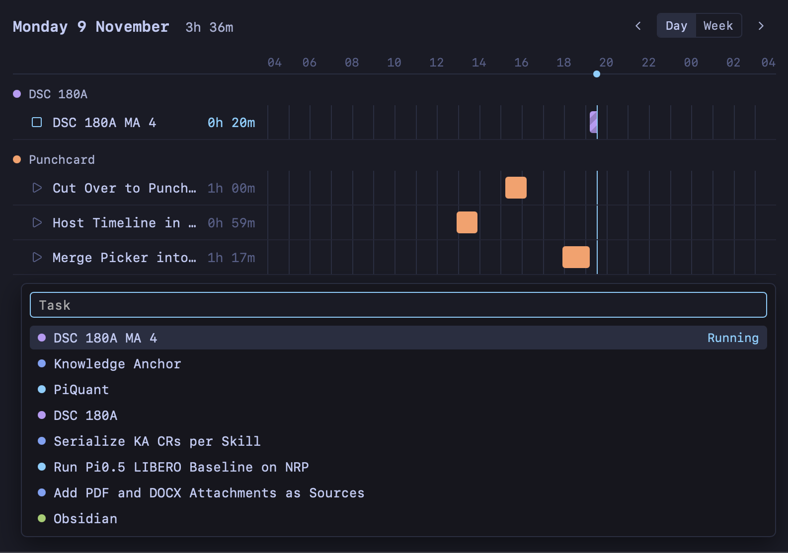
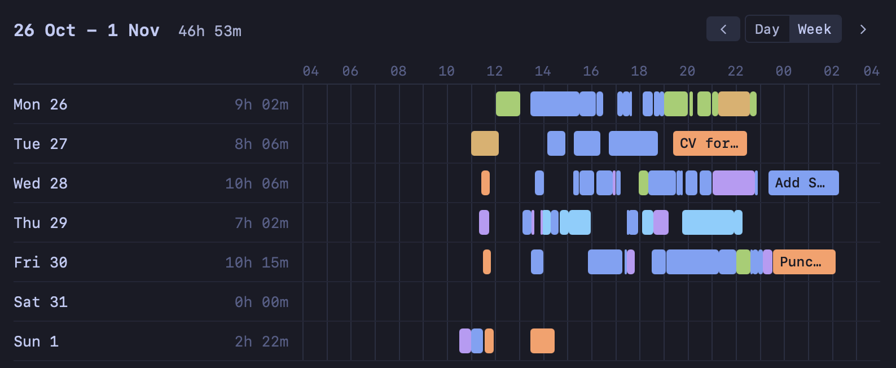

# Punchcard

Punchcard tracks time on Obsidian notes. Each stretch of work is a block in the note's `### Log`, and `punch`, a small desktop app, draws those blocks on a timeline where you start, stop, drag and edit them.

The day view shows one row per note, with a task picker to start or stop a task:



The week view shows one row per day, for looking back over the week:



## Install

Punchcard needs Rust, Node.js and `wasm-pack`:

```sh
cargo install wasm-pack --version 0.15.1 --locked
```

Then build and install `punch`:

```sh
npm install
npm run build && cargo install --path src-tauri --locked --features tauri/custom-protocol --bin punch
```

## Set up a vault

`punch` reads the vault at `$VAULT`. Without `VAULT` set, it reads `$WORK/Vault`, taking `WORK` from `~/.config/machine.env`.

The vault needs a `_Meta/Settings.md` whose frontmatter sets these keys:

```yaml
---
day_start_hour: 4
block_rejoin_minutes: 5
block_min_minutes: 3
timeline_block_minutes: 30
---
```

- `day_start_hour` is when a day begins, so with `4` a block at 01:30 counts toward the night before.
- `block_rejoin_minutes`: starting a task within this many minutes of stopping it continues the last block instead of opening a new one.
- `block_min_minutes`: stopping a block shorter than this, with nothing written under it, deletes it.
- `timeline_block_minutes` is the length of a block added by double-clicking the timeline.

A note is a task when it is tagged `#Task` or `#Project` and its `status` is `Not Started`, `In Progress` or `In Review`.

## Use

```sh
punch timeline        # today
punch timeline week   # this week
punch toggle "Note name"
```

`punch toggle` starts the note's block, or stops it when it is running. Each block is a heading under `### Log`, and an empty end means the block is still running:

```markdown
### Log
#### 26/11/09 19:06 -
#### 26/11/09 14:00 - 26/11/09 15:17
What I did in this block.
```

`punch sync` rebuilds `punchcard__worked_days` and `punchcard__worked_hours` in every note's frontmatter from its log, and reports malformed headings.

## Build from source

The block rules live once, in Rust (`src-tauri/core`). `punch` links them natively, and the JavaScript side loads them as WebAssembly. `wasm-pack` adds the `wasm32-unknown-unknown` target through rustup, fetches `wasm-opt`, and fetches the `wasm-bindgen` CLI version that `src-tauri/Cargo.lock` names. `npm run build` and `npm test` rebuild the wasm first.

To try the timeline against a copy of a vault:

```sh
VAULT=/path/to/vault-copy npm run tauri dev -- -- -- timeline
```
